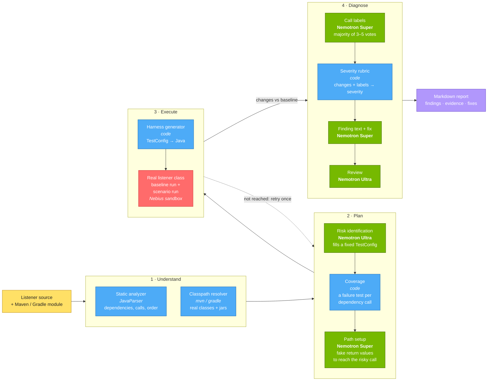
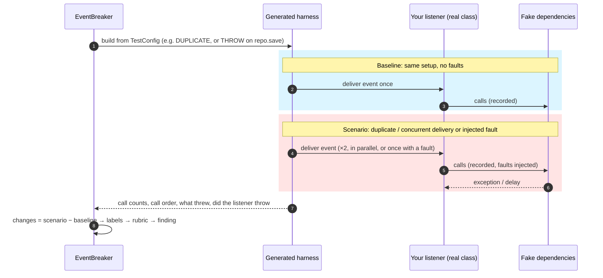
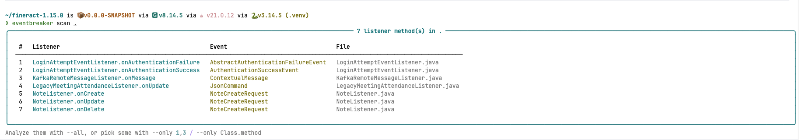

<div align="center">

# EventBreaker

**Break your event listeners before production does.**

AI-planned, measurement-backed reliability testing for Java event listeners.


[Overview](#overview) · [Architecture](#architecture) · [Design decisions](#design-decisions) ·
[Example](#example-input-and-output) · [Getting started](#getting-started) · [Usage](#usage) ·
[Tech stack](#tech-stack) · [Evaluation](#evaluation)


</div>

---

## Overview

Message brokers deliver events **at least once**. Sooner or later, every listener receives the same event twice, two
copies at the same moment, or a dependency that fails halfway through. The bugs this causes are silent: a payment
captured twice, a failure logged and swallowed while the offset is still acknowledged, a counter update lost to a race.

EventBreaker finds these bugs in your existing code, with no annotations or test code to write:

- **Plans** the tests with NVIDIA Nemotron, which reads the listener and picks the scenarios worth trying.
- **Runs your real compiled class** on your module's real classpath, with every dependency replaced by a recording fake.
- **Measures** each scenario against a fault-free baseline run.
- **Reports** only what it measured, with the evidence, a severity set by fixed rules, and a suggested fix.

Supported listeners: `@KafkaListener`, `@RabbitListener` / `@RabbitHandler`, `@JmsListener`, `@SqsListener`,
`@StreamListener`, Spring `@EventListener` / `@TransactionalEventListener`, Guava / Kill Bill `@Subscribe`.

---

## Architecture



<sub>Green = NVIDIA Nemotron via Nebius Token Factory · Blue = deterministic code · Red = Nebius sandbox (or local JVM)</sub>

### How one scenario is measured



---

## Design decisions

| # | Decision | Why |
|---|---|---|
| 1 | **The model fills a fixed test vocabulary instead of writing Java.** A `TestConfig` is a call pattern (`SINGLE`, `DUPLICATE`, `CONCURRENT`) plus faults (`THROW`, `THROW_ONCE`, `DELAY`) on named dependency calls. | Generated harnesses always compile, model mistakes cannot reach the JVM, and every test is easy to read in the report. |
| 2 | **Run the real class on the real classpath.** Only the listener's dependencies are faked. | The listener's own branches, catches and acknowledgement logic are what get tested, not a model's summary of them. |
| 3 | **Every finding is a measured change against a fault-free baseline.** | No change means no finding. This removes "the code looks risky" speculation. |
| 4 | **Models label, code decides.** Nemotron labels what each dependency call does and what it touches; a fixed rubric turns the measured changes plus those labels into severity. | Same measurements, same verdict. The severity reason is printed in every finding. |
| 5 | **Labels are voted.** 3 votes (5 for concurrency questions), run in parallel at temperature 0.7. | A single answer can flip between runs; a majority is stable, and the vote count shows how close it was. |
| 6 | **Code guarantees coverage.** A failure scenario is added for every dependency call the model did not already test. | Coverage does not depend on what the model happened to think of. |
| 7 | **Two model tiers.** Nemotron Ultra handles the hard reasoning (planning, review); Nemotron Super handles the many small calls (path setup, labels, text). | Quality where it matters, speed and cost everywhere else. |
| 8 | **Isolated execution.** Listener code runs in a Nebius sandbox; the local JVM is used for development. | Running someone else's code in a sandbox is safer. |
| 9 | **Model answers are cached on disk.** | Re-running an unchanged listener is instant, free and gives the same result. |

---

## Example input and output

**Input:** Apache Fineract's `KafkaRemoteMessageListener` (Apache-2.0), unchanged:

```java
@KafkaListener(topics = "${fineract.remote-job-message-handler.kafka.topic.name}")
public void onMessage(@Payload ContextualMessage contextualMessage, Acknowledgment acknowledgment) {
    try {
        StepExecutionRequest stepExecutionRequest = inputInterceptor.beforeHandleMessage(contextualMessage);
        stepExecutionRequestHandler.handle(stepExecutionRequest);
    } catch (Exception e) {
        log.error("Exception while processing Kafka message", e);
    } finally {
        inputInterceptor.afterHandleMessage();
    }
    acknowledgment.acknowledge();
}
```

```bash
eventbreaker scan . --only KafkaRemoteMessageListener.onMessage
```

**Output, step by step:**

**1. Plan:** Nemotron Ultra names the risks and turns each into a test; code adds a failure test for the one
dependency call the model did not cover.


**2. Measure:** each scenario runs the real listener class; calls are counted and compared with a fault-free run.


**3. Diagnose:** the rubric sets each severity from the measured changes; Nemotron writes the explanation and fix,
and Nemotron Ultra reviews it.


**4. Report:** everything is saved as Markdown in the tested project (`eventbreaker-reports/<Listener>/latest.md`).


---

## Getting started

### Prerequisites

| Tool | Version | Used for |
|---|---|---|
| Python | 3.12+ | the CLI |
| Java (JDK) | 21+ | building and running the test harness |
| Maven | 3.8+ | analyzer build, harness build, Maven classpaths |
| Nebius account | Token Factory API key | Nemotron models (and optionally the sandbox) |

### Install

```bash
git clone https://github.com/Ekta3009/EventBreaker
cd EventBreaker
mvn package -q                     # builds the static analyzer JAR, packaged with the CLI
pipx install .                     # or: python -m venv .venv && .venv/bin/pip install -e ".[dev]"
eventbreaker --version
```

### Configure

```bash
cat > .env <<'EOF'
NEBIUS_API_KEY=your_key_here
# NEBIUS_PROJECT_ID=your_project_id   # optional: run listener code in a Nebius sandbox
EOF
```

| Variable | Required | Effect |
|---|---|---|
| `NEBIUS_API_KEY` | yes | Nemotron Ultra + Super via Nebius Token Factory |
| `NEBIUS_PROJECT_ID` | no | if set, listener code runs in a Nebius sandbox; if unset, on the local JVM |

A `.env` in (or above) the directory you run from is loaded automatically; exported variables work too.

---

## Usage

Build the module that contains the listener once (`mvn compile`; multi-module Maven projects may need
`mvn install -DskipTests` at the root; Gradle compiles it for you). EventBreaker then asks that module's own build
for the classpath and caches it until a build file changes.

```bash
cd ~/src/your-service

eventbreaker scan .                                       # list every listener method in the repo
eventbreaker scan . --only OrderListener.onOrderPlaced    # analyze one listener method
eventbreaker scan . --only 1,3                            # ... or pick by number from the list
eventbreaker scan . --all                                 # ... or all of them
eventbreaker analyze path/to/OrderListener.java --method onOrderPlaced
```

| Option | Meaning |
|---|---|
| `--only` | listener methods to analyze, by number or `Class.method` |
| `--all` | analyze every listener found |
| `--method` | (`analyze`) which method of the class, if it has several listeners |
| `--classpath a.jar:b.jar` / `@cp.txt` | use this classpath instead of detecting it |
| `--fresh` | ignore cached model answers and ask again |

Reports are written to the tested project, wherever you run the command from:

```
<your project>/eventbreaker-reports/
└── OrderListener.onOrderPlaced/
    ├── latest.md                  ← always the newest run
    └── 2026-10-17_14-06-23.md     ← earlier runs, kept
```

The full path is printed at the end of each run.



### What it tests

| Scenario | What is measured | Typical bug found |
|---|---|---|
| Duplicate delivery | the same event delivered twice | double charge, duplicate message sent |
| Concurrent delivery | two copies delivered in parallel | lost update, broken lockout counter |
| Dependency failure | a dependency call throws (once, or every time) | failure swallowed and acknowledged, work lost |
| Slow dependency | a dependency call is delayed, so concurrent copies overlap | widens the window for race conditions |

### Severity rules

| Measured situation | Severity |
|---|---|
| A dependency failed, the listener swallowed it, and a write went missing or failed | **HIGH** (work silently lost) |
| A dependency failed after a side effect completed, and the listener threw | **HIGH** for brokers (redelivery repeats it), else **MEDIUM** |
| A duplicate repeated a side effect on money, security or an external message | **HIGH** (**MEDIUM** for other side effects, **LOW** in-process) |
| A duplicate repeated only a refresh | **LOW** |
| Concurrent runs can interfere on calls that ran | **HIGH** for money / security, else **MEDIUM** |
| Only reads or idempotent writes changed | no finding (listed as harmless) |

---

## Tech stack

| Layer | Technology |
|---|---|
| AI models | NVIDIA **Nemotron-3-Ultra-550B** (planning, review) and **Nemotron-3-Super-120B** (path setup, labels, text) |
| Inference | **Nebius Token Factory** (OpenAI-compatible API) |
| Isolated execution | **Nebius sandbox** via ConTree SDK (Alpine + OpenJDK 21) |
| Static analysis | Java 21, JavaParser, Jackson (packaged as one JAR) |
| Test execution | Mockito 5 (inline mock maker), Maven; classpath from Maven or Gradle |
| CLI | Python 3.12+, Typer, Rich, Pydantic v2, OpenAI SDK |
| Tests | pytest, JUnit 5 |

---

## Evaluation

EventBreaker was run on unchanged listeners from three open-source products: Apache Fineract (core banking),
Kill Bill (subscription billing) and Eclipse hawkbit (IoT device updates). Before each run, the expected risks were written
down by hand, including negative controls where a finding would be a false positive. A risk counts only if a run
measured it.

| | Tuning set | Unseen set |
|---|---|---|
| Products · transports | Fineract, Kill Bill · Kafka, Spring events, Kill Bill bus | Kill Bill, hawkbit · Kill Bill bus, RabbitMQ |
| Listener methods | 9 | 11 |
| Expected risks found | 10 / 14 (7 at the expected severity, 3 rated higher) | 0 detectable (risky line not reached) |
| False positives | 0 | 1 |
| Negative controls held | 3 / 3 | 4 / 4 |
| Same result when every model answer is re-asked | 7 / 9 listeners | n/a |

The tuning set is where prompts and rules were developed; the unseen set was never used for tuning. On unseen code
the *judgement* held: where a run reached the risky line, the verdict matched the expectation in every case but one.
What did not carry over is *reach*, i.e. driving unfamiliar code to the risky line (see Limitations).

Examples of measured findings (tuning set):

- **Fineract `KafkaRemoteMessageListener` (HIGH):** a failed batch step is logged and swallowed, and the Kafka
  offset is still acknowledged. The work is lost and never redelivered.
- **Fineract `LoginAttemptEventListener` (HIGH):** two simultaneous failed logins read the same counter and both
  write it back. One attempt is lost, which weakens the account lockout.
- **Kill Bill `OverdueListener` (HIGH):** if looking up parent/child accounts fails, the error is swallowed and
  those accounts' overdue state is never refreshed.

### Limitations

- The run must **reach** the risky line. Code that needs list values, event subtypes, checked exceptions or generic
  registries can stop early; the report then says "not reached" instead of guessing.
- Each listener method is analyzed on its own; bugs that span several methods are out of scope.
- Dependencies are faked, so EventBreaker tests the listener's own handling, not the database or broker.

---

## Project structure

```
eventbreaker/
├── cli/main.py               analyze / scan commands, pipeline
├── analyzer/bridge.py        calls the Java static analyzer (src/main/java/com/eventbreaker/analyzer)
├── classpath/resolver.py     classpath from the listener's Maven / Gradle module
├── agent/                    nemotron.py (risks) · path_setup.py · llm.py · usage.py (token log)
├── scenarios/                models.py (TestConfig) · coverage.py · executor.py (harness) · experiment.py
├── sandbox/executor.py       Nebius sandbox run
├── diagnosis/                classify.py (voted labels) · rubric.py (severity) · analyzer.py · reviewer.py
└── report/reporter.py        Markdown report
src/test/resources/real-world/  listeners used for evaluation + EXPECTED / RESULTS
tests/                          pytest suite (run with `pytest`)
```

## License

[MIT](LICENSE). Listener sources under `src/test/resources/real-world/` keep their original licenses (Apache-2.0).

## Acknowledgements

Built for the **Nebius × NVIDIA Global AI Hackathon 2026**. Evaluation listeners from
[Apache Fineract](https://github.com/apache/fineract), [Kill Bill](https://github.com/killbill/killbill) and
[Eclipse hawkbit](https://github.com/eclipse-hawkbit/hawkbit).
