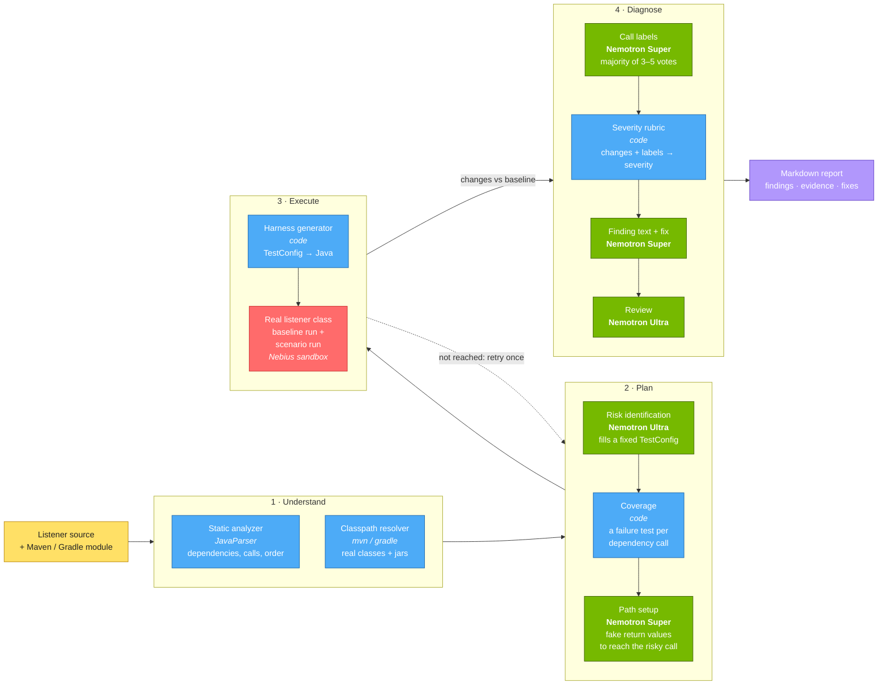
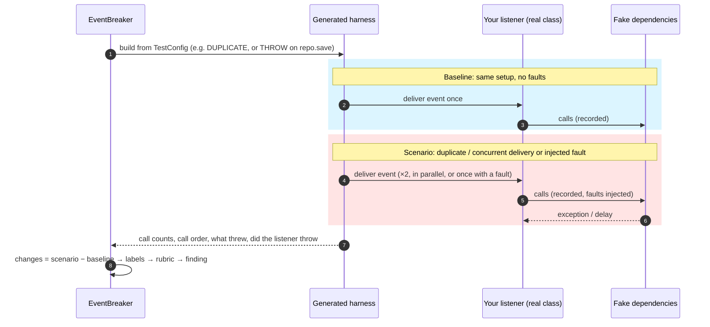
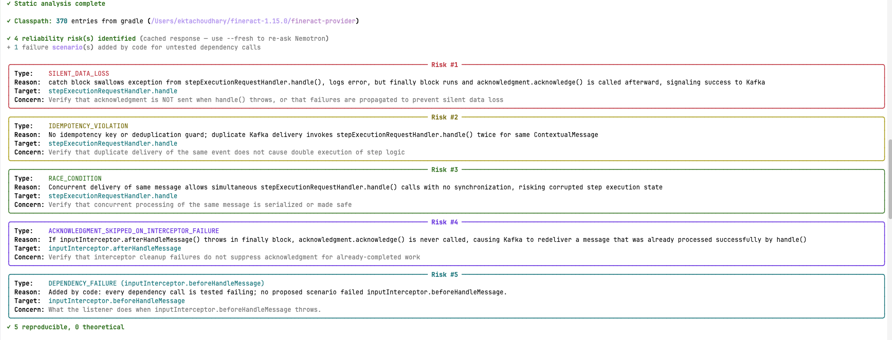
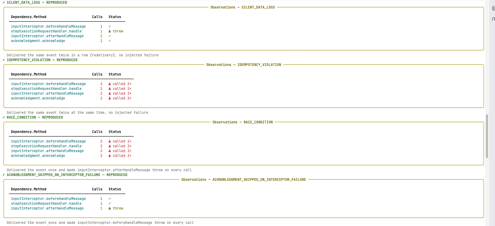
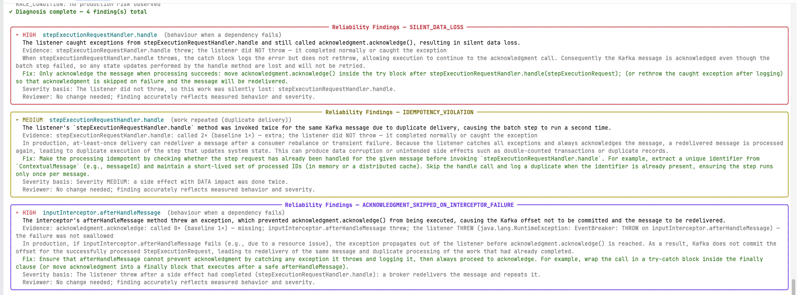
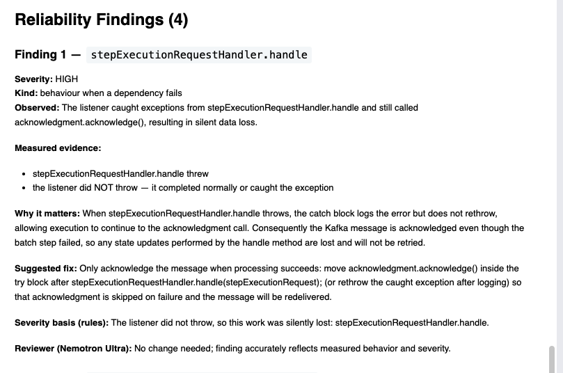

<div align="center">

# EventBreaker

**Break your event listeners before production does.**

AI-planned, measurement-backed reliability testing for Java event listeners.


[How it works](#how-it-works) · [Example](#example) · [Getting started](#getting-started) · [Usage](#usage) ·
[Results](#results)

</div>

---

## Overview

Message brokers deliver events **at least once**, so every listener eventually gets the same event twice, two copies at
once, or a dependency that fails halfway. The resulting bugs are silent: a payment made twice, a failure swallowed while
the message is still acknowledged, an update lost to a race.

EventBreaker finds them in your existing code, with no test code to write:

- **Plans** the tests with NVIDIA Nemotron, which reads the listener and picks the scenarios worth trying.
- **Runs your real compiled class**, with every dependency replaced by a recording fake.
- **Measures** each scenario against a fault-free run.
- **Reports** only what it measured, with evidence, a rule-based severity and a suggested fix.

Works with `@KafkaListener`, `@RabbitListener`, `@JmsListener`, Spring `@EventListener` / `@TransactionalEventListener`
and Guava / Kill Bill `@Subscribe`.

---

## How it works



<sub>Green = NVIDIA Nemotron via Nebius Token Factory · Blue = deterministic code · Red = Nebius sandbox (or local JVM)</sub>

**How one scenario is measured:**



**Key design choices**

| Choice | Why |
|---|---|
| The model fills a fixed test format (`TestConfig`); it never writes Java | generated tests always compile, and every test is readable |
| The real listener class runs; only its dependencies are faked | its own catches, retries and acknowledgements are what get tested |
| A finding needs a measured change against a fault-free run | no change, no finding: no "this looks risky" guesses |
| Models label calls; fixed rules decide severity | same measurements, same verdict; the reason is printed |
| Code adds a failure test for every dependency call the model skipped | coverage does not depend on the model |
| Ultra for planning and review, Super for the many small calls | quality where it matters, speed and cost elsewhere |

### What it tests

| Scenario | What is measured | Typical bug found |
|---|---|---|
| Duplicate delivery | the same event delivered twice | double charge, duplicate message sent |
| Concurrent delivery | two copies delivered in parallel | lost update, broken lockout counter |
| Dependency failure | a dependency call throws (once, or every time) | failure swallowed and acknowledged, work lost |
| Slow dependency | a dependency call is delayed, so concurrent copies overlap | widens the window for race conditions |

---

## Example

Apache Fineract's `KafkaRemoteMessageListener`, unchanged:

```java
@KafkaListener(topics = "${fineract.remote-job-message-handler.kafka.topic.name}")
public void onMessage(@Payload ContextualMessage contextualMessage, Acknowledgment acknowledgment) {
    try {
        StepExecutionRequest stepExecutionRequest = inputInterceptor.beforeHandleMessage(contextualMessage);
        stepExecutionRequestHandler.handle(stepExecutionRequest);
    } catch (Exception e) {
        log.error("Exception while processing Kafka message", e);
    } finally {
        inputInterceptor.afterHandleMessage();
    }
    acknowledgment.acknowledge();
}
```

**1. Plan:** Nemotron Ultra names the risks and turns each into a test.



**2. Measure:** each scenario runs the real listener; calls are compared with a fault-free run.



**3. Diagnose:** rules set the severity; Nemotron explains it and suggests a fix.



**4. Report:** saved as Markdown in the tested project.



---

## Getting started

**You need:** Python 3.12+, Java 21+, Maven, and a [Nebius Token Factory](https://tokenfactory.nebius.com/) API key.

```bash
pipx install https://github.com/Ekta3009/EventBreaker/releases/download/v0.1.1/eventbreaker-0.1.1-py3-none-any.whl
export NEBIUS_API_KEY=your_key
export NEBIUS_PROJECT_ID=your_project_id   # optional: run the tests in a Nebius sandbox instead of local Java
```

### Try it

```bash
git clone https://github.com/openMF/paymenthub-ee-bulk-processor
cd paymenthub-ee-bulk-processor && git checkout 06ff677
eventbreaker scan . --only Consumers.listenTopicGsma
```

Expected: a **HIGH** finding. A redelivered Kafka message starts the same payment twice. The report is saved to
`eventbreaker-reports/Consumers.listenTopicGsma/latest.md`.

---

## Usage

Build your project once (`mvn install -DskipTests`; Gradle projects need nothing), then from its folder:

```bash
eventbreaker scan .                                  # list every listener
eventbreaker scan . --only 1,3                       # test some, by number or Class.method
eventbreaker scan . --all                            # test all of them
```

Add `--fresh` to ask the models again instead of using cached answers.

**If a listener can't be tested** (its test does not compile, the risky line is not reached, or the listener never
finishes), the report says so and makes no finding. EventBreaker never reports a risk it did not measure.

---

## Results

Tested on **61 listener methods from 9 open-source projects**. EventBreaker found **46 reliability risks that we had
confirmed by reading the source code before the runs**, including these real bugs:

- **Mifos Payment Hub (HIGH):** a redelivered Kafka message starts the same international payment twice.
- **Apache Fineract (HIGH):** a failed batch step is swallowed and the Kafka message is still acknowledged, so the work
  is lost.
- **DIGIT (HIGH):** a failure while generating audit records is caught and logged, with no retry, so the change is
  never audited.
- **Fineract (HIGH):** two simultaneous failed logins both update the same counter, so one is lost and the account
  lockout is weakened.

**Limitations:** the run has to reach the risky line; objects a listener creates itself, or settings its constructor
reads from configuration, are not faked, so those runs end as "not reached" or "error" (never as a guess). Each method is
tested on its own, against fakes, not a real database or broker.

---

## Built with

NVIDIA **Nemotron-3-Ultra-550B** and **Nemotron-3-Super-120B** via **Nebius Token Factory** · **Nebius sandbox**
(ConTree SDK) · Java 21, JavaParser, Mockito 5, Maven / Gradle · Python 3.12, Typer, Rich, Pydantic

## License

[MIT](LICENSE). Built for the **Nebius × NVIDIA Global AI Hackathon 2026**. Evaluation listeners from Apache Fineract,
Kill Bill, Eclipse hawkbit, DIGIT, Graylog, Apache Syncope, DHIS2, Mifos Payment Hub and Sunbird-RC (their own
licenses).
