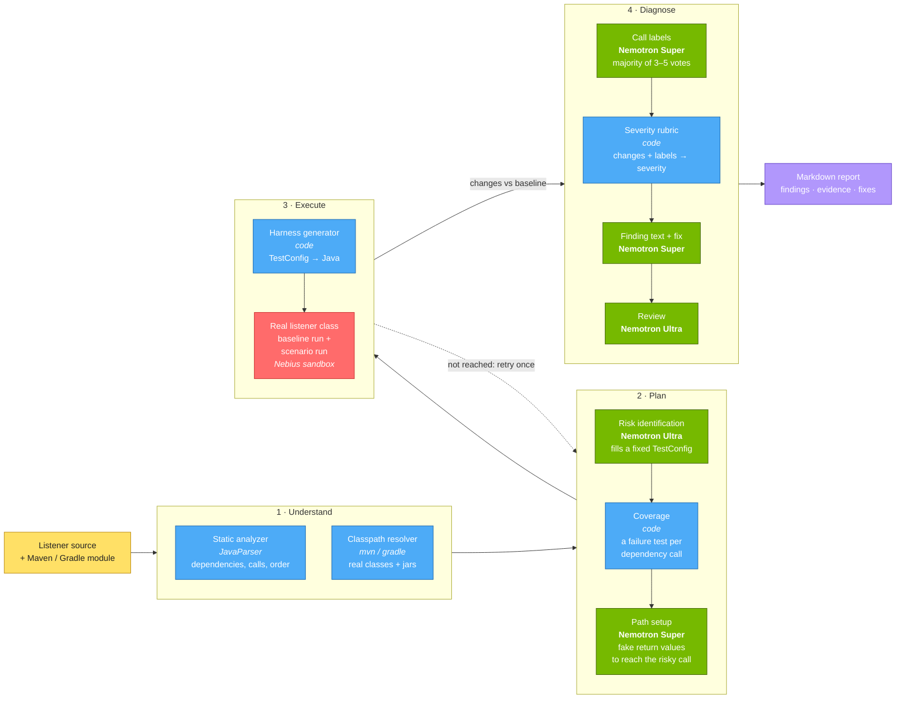
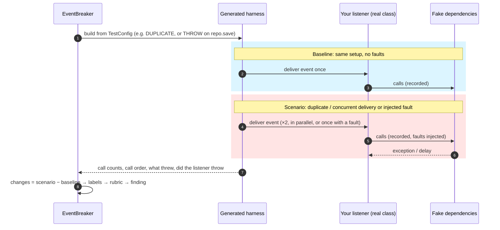

<div align="center">

# EventBreaker

**Break your event listeners before production does.**

AI-planned, measurement-backed reliability testing for Java event listeners.


[Overview](#overview) · [Architecture](#architecture) · [Design decisions](#design-decisions) ·
[Example](#example-input-and-output) · [Getting started](#getting-started) · [Usage](#usage) ·
[Tech stack](#tech-stack) · [Evaluation](#evaluation)

</div>

---

## Overview

Message brokers deliver events **at least once**. Sooner or later, every listener receives the same event twice, two
copies at the same moment, or a dependency that fails halfway through. The bugs this causes are silent: a payment
captured twice, a failure logged and swallowed while the offset is still acknowledged, a counter update lost to a race.

EventBreaker finds these bugs in your existing code, with no annotations or test code to write:

- **Plans** the tests with NVIDIA Nemotron, which reads the listener and picks the scenarios worth trying.
- **Runs your real compiled class** on your module's real classpath, with every dependency replaced by a recording fake.
- **Measures** each scenario against a fault-free baseline run.
- **Reports** only what it measured, with the evidence, a severity set by fixed rules, and a suggested fix.

### Supported listeners

Evaluated on 61 listener methods from 9 open-source products (see [Evaluation](#evaluation)):

| Listener kind | Evaluated methods | Products |
|---|---|---|
| Spring `@EventListener` / `@TransactionalEventListener` (7 of them `@Async` or after-commit) | 23 | Fineract, Apache Syncope, DHIS2 |
| Guava / Kill Bill `@Subscribe` | 22 | Kill Bill, Graylog |
| `@KafkaListener` | 14 | Fineract, DIGIT, Mifos Payment Hub, Sunbird-RC |
| `@RabbitListener` / `@RabbitHandler` | 1 | Eclipse hawkbit |
| `@JmsListener` | 1 | DHIS2 |

`@SqsListener` and `@StreamListener` methods are recognized and analyzed the same way, but have not been evaluated yet.

Severity follows each transport's delivery rules: a broker redelivers after a thrown exception (Kafka with no error
handler retries about 10 times, then skips the record); a Guava `EventBus` logs it and drops the event, and never runs
a subscriber twice at once unless it is marked `@AllowConcurrentEvents`; Kill Bill's persistent bus retries; an
`@Async` or after-commit Spring listener's exception is logged and dropped.

---

## Architecture



<sub>Green = NVIDIA Nemotron via Nebius Token Factory · Blue = deterministic code · Red = Nebius sandbox (or local JVM)</sub>

### How one scenario is measured



---

## Design decisions

| # | Decision | Why |
|---|---|---|
| 1 | **The model fills a fixed test vocabulary instead of writing Java.** A `TestConfig` is a call pattern (`SINGLE`, `DUPLICATE`, `CONCURRENT`) plus faults (`THROW`, `THROW_ONCE`, `DELAY`) on named dependency calls. | Generated harnesses always compile, model mistakes cannot reach the JVM, and every test is easy to read in the report. |
| 2 | **Run the real class on the real classpath.** Only the listener's dependencies are faked. | The listener's own branches, catches and acknowledgement logic are what get tested, not a model's summary of them. |
| 3 | **Every finding is a measured change against a fault-free baseline.** | No change means no finding. This removes "the code looks risky" speculation. |
| 4 | **Models label, code decides.** Nemotron labels what each dependency call does and what it touches; a fixed rubric turns the measured changes plus those labels into severity. | Same measurements, same verdict. The severity reason is printed in every finding. |
| 5 | **Labels are voted.** 3 votes (5 for concurrency questions), run in parallel at temperature 0.7. | A single answer can flip between runs; a majority is stable, and the vote count shows how close it was. |
| 6 | **Code guarantees coverage.** A failure scenario is added for every dependency call the model did not already test. | Coverage does not depend on what the model happened to think of. |
| 7 | **Two model tiers.** Nemotron Ultra handles the hard reasoning (planning, review); Nemotron Super handles the many small calls (path setup, labels, text). | Quality where it matters, speed and cost everywhere else. |
| 8 | **Isolated execution.** Listener code runs in a Nebius sandbox; the local JVM is used for development. | Running someone else's code in a sandbox is safer. |
| 9 | **Model answers are cached on disk.** | Re-running an unchanged listener is instant, free and gives the same result. |

---

## Example input and output

**Input:** Apache Fineract's `KafkaRemoteMessageListener` (Apache-2.0), unchanged:

```java
@KafkaListener(topics = "${fineract.remote-job-message-handler.kafka.topic.name}")
public void onMessage(@Payload ContextualMessage contextualMessage, Acknowledgment acknowledgment) {
    try {
        StepExecutionRequest stepExecutionRequest = inputInterceptor.beforeHandleMessage(contextualMessage);
        stepExecutionRequestHandler.handle(stepExecutionRequest);
    } catch (Exception e) {
        log.error("Exception while processing Kafka message", e);
    } finally {
        inputInterceptor.afterHandleMessage();
    }
    acknowledgment.acknowledge();
}
```

```bash
eventbreaker scan . --only KafkaRemoteMessageListener.onMessage
```

**Output, step by step:**

**1. Plan:** Nemotron Ultra names the risks and turns each into a test; code adds a failure test for the one
dependency call the model did not cover.


**2. Measure:** each scenario runs the real listener class; calls are counted and compared with a fault-free run.


**3. Diagnose:** the rubric sets each severity from the measured changes; Nemotron writes the explanation and fix,
and Nemotron Ultra reviews it.


**4. Report:** everything is saved as Markdown in the tested project (`eventbreaker-reports/<Listener>/latest.md`).


---

## Getting started

### Prerequisites

| Tool | Version | Used for |
|---|---|---|
| Python | 3.12+ | the CLI |
| Java (JDK) | 21+ | building and running the test harness |
| Maven | 3.8+ | analyzer build, harness build, Maven classpaths |
| Nebius account | Token Factory API key | Nemotron models (and optionally the sandbox) |

### Install

From the release (the wheel already contains the static analyzer JAR):

```bash
pipx install https://github.com/Ekta3009/EventBreaker/releases/download/v0.1.1/eventbreaker-0.1.1-py3-none-any.whl
# or, in a virtual environment: pip install <the same URL>
eventbreaker --version
```

From source:

```bash
git clone https://github.com/Ekta3009/EventBreaker
cd EventBreaker
mvn package -q                     # builds the static analyzer JAR, packaged with the CLI
pipx install .                     # or: python -m venv .venv && .venv/bin/pip install -e ".[dev]"
```

### Configure

```bash
cat > .env <<'EOF'
NEBIUS_API_KEY=your_key_here
# NEBIUS_PROJECT_ID=your_project_id   # optional: run listener code in a Nebius sandbox
EOF
```

| Variable | Required | Effect |
|---|---|---|
| `NEBIUS_API_KEY` | yes | Nemotron Ultra + Super via Nebius Token Factory |
| `NEBIUS_PROJECT_ID` | no | if set, listener code runs in a Nebius sandbox; if unset, on the local JVM |

A `.env` in (or above) the directory you run from is loaded automatically; exported variables work too.

### Try it in 5 minutes

Run it on a real Kafka listener in [Mifos Payment Hub](https://github.com/openMF/paymenthub-ee-bulk-processor)
(Apache-2.0) that starts an international payment, at the exact commit we tested. Needs JDK 21.

```bash
git clone https://github.com/openMF/paymenthub-ee-bulk-processor
cd paymenthub-ee-bulk-processor
git checkout 06ff677
eventbreaker scan .                                          # lists 2 listener methods
eventbreaker scan . --only Consumers.listenTopicGsma         # Gradle compiles the module on the first run
```

Expected: a **HIGH** finding. Delivered twice, the listener starts the payment workflow
(`zeebeProcessStarter.startZeebeWorkflow`) twice, because there is no idempotency key. Two **MEDIUM** findings follow: a
failing workflow start or a malformed message is retried about 10 times, then skipped, because no error handler is
configured. The second listener, `listenTopicSlcb`, only logs, and should give no findings. Model answers can vary a
little between runs; the report shows the evidence behind every finding.

---

## Usage

Build the module that contains the listener once (`mvn compile`; multi-module Maven projects may need
`mvn install -DskipTests` at the root; Gradle compiles it for you). EventBreaker then asks that module's own build
for the classpath and caches it until a build file changes.

```bash
cd ~/src/your-service

eventbreaker scan .                                       # list every listener method in the repo
eventbreaker scan . --only OrderListener.onOrderPlaced    # analyze one listener method
eventbreaker scan . --only 1,3                            # ... or pick by number from the list
eventbreaker scan . --all                                 # ... or all of them
eventbreaker analyze path/to/OrderListener.java --method onOrderPlaced
```

| Option | Meaning |
|---|---|
| `--only` | listener methods to analyze, by number or `Class.method` |
| `--all` | analyze every listener found |
| `--method` | (`analyze`) which method of the class, if it has several listeners |
| `--classpath a.jar:b.jar` / `@cp.txt` | use this classpath instead of detecting it |
| `--fresh` | ignore cached model answers and ask again |

Reports are written to the tested project, wherever you run the command from:

```
<your project>/eventbreaker-reports/
└── OrderListener.onOrderPlaced/
    ├── latest.md                  ← always the newest run
    └── 2026-10-17_14-06-23.md     ← earlier runs, kept
```

The full path is printed at the end of each run.


### What to expect on your own code

EventBreaker has to compile a test harness against your listener and drive it to the risky line. On a codebase it has
never seen, that does not always work:

- **The harness may not build**, usually because a class the listener uses is not on the module's classpath. You see
  `Could not build a test harness: X is not on the listener's classpath`. Build the module first, or pass the missing
  jars with `--classpath`.
- **The risky line may not be reached.** For example, a flag set in the constructor from configuration makes the
  listener return early. The scenario is marked **not reached**.
- **A listener may block** (it waits on something the fakes never provide). It is stopped after 180 s and marked as an
  error.

In all three cases the report says what happened and makes **no finding** for that scenario. EventBreaker never
reports a risk it did not measure. How often this happened on new code is in [Evaluation](#evaluation): on first
contact with the held-out products, 4 of 22 listeners ran; after general fixes, 20 of 22 did.

### What it tests

| Scenario | What is measured | Typical bug found |
|---|---|---|
| Duplicate delivery | the same event delivered twice | double charge, duplicate message sent |
| Concurrent delivery | two copies delivered in parallel | lost update, broken lockout counter |
| Dependency failure | a dependency call throws (once, or every time) | failure swallowed and acknowledged, work lost |
| Slow dependency | a dependency call is delayed, so concurrent copies overlap | widens the window for race conditions |

### Severity rules

| Measured situation | Severity |
|---|---|
| A dependency failed, the listener swallowed it, and a write went missing or failed | **HIGH** (work silently lost) |
| A dependency failed after a side effect completed, and the listener threw | **HIGH** for brokers (redelivery repeats it), else **MEDIUM** |
| A duplicate repeated a side effect on money, security or an external message | **HIGH** (**MEDIUM** for other side effects, **LOW** in-process) |
| A duplicate repeated only a refresh | **LOW** |
| Concurrent runs can interfere on calls that ran | **HIGH** for money / security, else **MEDIUM** |
| Only reads or idempotent writes changed | no finding (listed as harmless) |

---

## Tech stack

| Layer | Technology |
|---|---|
| AI models | NVIDIA **Nemotron-3-Ultra-550B** (planning, review) and **Nemotron-3-Super-120B** (path setup, labels, text) |
| Inference | **Nebius Token Factory** (OpenAI-compatible API) |
| Isolated execution | **Nebius sandbox** via ConTree SDK (Alpine + OpenJDK 21 or 25, chosen from the listener's bytecode version) |
| Static analysis | Java 21, JavaParser, Jackson (packaged as one JAR) |
| Test execution | Mockito 5 (inline mock maker), Maven; classpath from Maven or Gradle |
| CLI | Python 3.12+, Typer, Rich, Pydantic v2, OpenAI SDK |
| Tests | pytest, JUnit 5 |

---

## Evaluation

EventBreaker was run on **61 unchanged listener methods from 9 open-source products** (banking, billing, payments,
identity, health data, IoT, logging). Before the first run on each product, the expected risks were written down by
hand from the source, including **negative controls**: places where a finding would be a false positive. A risk counts
only if a run measured it. Expected severities were never used to tune prompts or rules.

### Real bugs it found

- **Mifos Payment Hub `Consumers.listenTopicGsma` (HIGH):** a redelivered Kafka message starts a second international
  remittance workflow with a fresh transaction id, so the money moves twice; there is no idempotency key. Measured in the
  Nebius sandbox on the final run.
- **Apache Fineract `KafkaRemoteMessageListener` (HIGH):** a failed batch step is logged and swallowed, and the Kafka
  offset is still acknowledged. The work is lost and never redelivered.
- **DIGIT `AuditLogsConsumer` (HIGH):** a failure while generating audit records is caught and logged, with no retry or
  dead-letter topic, so the change is never audited.
- **Fineract `LoginAttemptEventListener` (HIGH):** two simultaneous failed logins read the same counter and both write
  it back. One attempt is lost, which weakens the account lockout.
- **Apache Syncope `ElasticsearchIndexManager` / DHIS2 `FileResourceEventListener` (MEDIUM):** both run after the
  transaction commits, where Spring only logs an exception. A failed index update leaves search results stale; a failed
  upload leaves a file record with no content. Nothing retries either.

### Results in three groups

The products were added in three rounds. Each round found gaps in the tool, mostly in *reach* (driving unfamiliar code
to the risky line). Those gaps were fixed in general ways (payload types, delivery rules per transport, checked
exceptions), and the round was measured again. So only the **first contact** with each round is a blind result; the
later columns show what the fixes changed.

| Set | Products · transports | Methods | First contact | After fixes |
|---|---|---|---|---|
| Tuning | Fineract, Kill Bill · Kafka, Spring events, Kill Bill bus | 9 | — (the tool was developed here) | **12 / 14** found (8 exact, 4 rated higher) · negative controls 3 / 3 |
| Development | Kill Bill, hawkbit, DIGIT, Graylog · Kill Bill bus, RabbitMQ, Kafka, Guava | 30 | **0 / 26** found (reach) | **20 / 26** found (5 exact, 15 rated higher) · negative controls 20 / 22 run · 2 false positives |
| Held-out | Apache Syncope, DHIS2, Mifos Payment Hub, Sunbird-RC · Spring events (incl. `@Async`, after-commit), Kafka, JMS | 22 | **0 / 26** found (4 of 22 harnesses ran) | **14 / 26** found (8 exact, 6 rated higher) · negative controls 13 / 17 run · 6 false positives · 20 of 22 harnesses ran |

<sub>Held-out "after fixes" is the final run in the Nebius sandbox. It found two crashes in the tool (sandbox packaging
dropped log4j's runtime files; one Maven module's own plugin settings hid its dependencies); both were fixed and the two
affected listeners re-run. Tuning and development were last measured on the local JVM (Oct 17–19), before the fixes
that came from the held-out round.</sub>

What the numbers say:

- **Judgement carries over; reach does not, at first.** On first contact, almost every miss was a run that never got to
  the risky line. Where a run did get there, the verdict usually matched. After general reach fixes, 20 of 26 expected
  risks are found in the development set and 14 of 26 in the held-out set, where reach is still the main gap.
- **Severity is often one level high.** The rubric rates a repeated money or external-message side effect HIGH, even
  where the system is designed for repeats (documented at-least-once webhooks, for example).
- **Negative controls mostly hold.** The remaining false positives come from two sources: concurrency votes on
  harmless in-memory code (two cache invalidations "racing"), and recovery the tool cannot see (a failed flush whose
  buffer is kept for the next one).

### Limitations

- The run must **reach** the risky line. Logic behind runtime-registered handlers, flags set in the constructor from
  configuration, or event subtypes can stop it early; the report then says "not reached" instead of guessing.
- Concurrency verdicts are a vote (5 votes) and can flip between runs on harmless in-memory code.
- Only objects passed **into** the listener are faked. A listener that builds its own objects with `new` runs them for
  real (Syncope's WA startup listener runs Apereo CAS's configuration check, which never finishes on fakes), and a
  constructor that reads configuration (a number or an on/off flag) gets no value: the listener fails to start or returns
  early. The report shows "error" or "not reached" for these, never a guess.
- Each listener method is analyzed on its own; bugs that span several methods or several different messages (for
  example a field overwritten by one message and read by the next) are out of scope.
- Dependencies are faked, so EventBreaker tests the listener's own handling, not the database or broker.

---

## Project structure

```
eventbreaker/
├── cli/main.py               analyze / scan commands, pipeline
├── analyzer/bridge.py        calls the Java static analyzer (src/main/java/com/eventbreaker/analyzer)
├── classpath/resolver.py     classpath from the listener's Maven / Gradle module
├── agent/                    nemotron.py (risks) · path_setup.py · llm.py · usage.py (token log)
├── scenarios/                models.py (TestConfig) · coverage.py · executor.py (harness) · experiment.py
├── sandbox/executor.py       Nebius sandbox run
├── diagnosis/                classify.py (voted labels) · rubric.py (severity) · analyzer.py · reviewer.py
└── report/reporter.py        Markdown report
src/test/resources/real-world/  listeners used for evaluation + EXPECTED / RESULTS
tests/                          pytest suite (run with `pytest`)
```

## License

[MIT](LICENSE). Listener sources under `src/test/resources/real-world/` keep their original licenses (Apache-2.0).

## Acknowledgements

Built for the **Nebius × NVIDIA Global AI Hackathon 2026**. Evaluation listeners from
[Apache Fineract](https://github.com/apache/fineract), [Kill Bill](https://github.com/killbill/killbill) and
[Eclipse hawkbit](https://github.com/eclipse-hawkbit/hawkbit).
